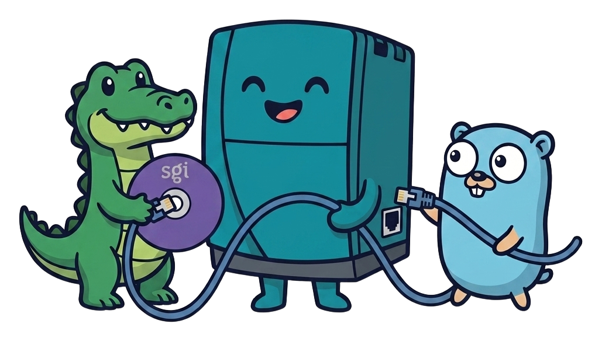

# instigator

<p align="center">
  
</p>

Instigator installs IRIX over the network from SGI CD images and shares host
folders with SGI machines and emulators. It is a single Go binary for Linux,
macOS, and Windows.

For installs, it reads the images directly and provides BOOTP, TFTP, and rsh
for the SGI boot firmware (PROM) and IRIX installer (`inst`). Several discs
can become one distribution tree, so you don't have to extract the media,
build a separate install tree, or swap sources by hand. The images stay
read-only. If two discs disagree about a file, you choose which copy wins in
the configuration.

For file sharing, it runs its own writable NFSv2/v3 server. Use it to move
files between your host and IRIX without configuring a host NFS service. With
an emulator's private QEMU network, it runs without root or privileged host
ports. Install services and shares can run together or separately.

## Start here

| I want to… | Guide |
| --- | --- |
| Choose a shipped config and install IRIX | [Installing IRIX](docs/install.md) |
| Install IRIX 5.3 or 6.2 | [IRIX 5.3 and 6.2](docs/install.md#irix-53-and-62) |
| Use my own media or change package selections | [Configuration](docs/configuration.md) |
| Share a host folder with IRIX | [Sharing files with IRIX](docs/sharing.md) |
| Extract files or manual pages without installing IRIX | [Extracting installed files](docs/extract.md) |
| Record an install, diagnose a connection, or run a service | [Running and troubleshooting the server](docs/operations.md) |
| Run Instigator from another program | [JSON output](docs/json-output.md) |
| Check NFS or private-network wire behaviour | [Network reference](docs/network-reference.md) |

## Get Instigator

Download an archive for your host from the [releases
page](https://github.com/jamesbraid/instigator/releases) and unpack it.
Release archives include the example configuration, ready-made configs, and
these guides. Use the docs from the same release as your binary.

To build from a checkout, use Go 1.27.1 or newer:

```sh
go build -o instigator ./cmd/instigator
```

`./instigator --version` prints the version recorded by Go. Local changes add
`+dirty`. Builds without source metadata report `(devel)`.

The commands below assume the binary is in your current directory. On Windows,
use `instigator.exe`. Run host-network install services as Administrator
instead of using `sudo`.

## First install

The configs in [`configs/`](configs/) have media URLs filled in for IRIX
6.5.30, 6.5.22, 6.2 and 5.3. Choose one for your machine under [Choose a
config](docs/install.md#choose-a-config). For an IRIX 6.5.30 standard install:

```sh
cp configs/irix-6.5.30-standard.yaml instigator.yaml
cp -R configs/addons .
```

Edit `server_ip`, `netmask`, and the client MAC and IP. The supplied addresses
are placeholders. At the SGI PROM, `printenv eaddr` shows the MAC address. The
second command copies the add-on files beside your config so its relative
paths work if you enable them. Check the config, then start the server:

```sh
./instigator check instigator.yaml
sudo ./instigator serve instigator.yaml
```

Leave the server running. At the SGI, boot from the network and start the
installer as [Machines and boot files](docs/install.md#machines-and-boot-files)
describes for your machine. With an IRIX 6.5 config, load `/irix.cmds` at
`Inst>` to apply its package choices and add-ons. If an `Install software
from` menu appears, enter the number beside `done` to let the script
continue. IRIX 5.3 and 6.2 have no `admin source`, so type the `from`,
`install default` and `go` lines in [IRIX 5.3 and
6.2](docs/install.md#irix-53-and-62).

## First file share

For a physical machine on your LAN, bind to the host's install-network
address. Replace `192.0.2.10` with that address:

```sh
mkdir -p "$HOME/sgi-share"
sudo ./instigator share --listen 192.0.2.10 src "$HOME/sgi-share"
```

On IRIX, as root:

```sh
mkdir -p /mnt/src
mount 192.0.2.10:/src /mnt/src
```

Writes from IRIX change the host files. They run with the permissions of the
user who started Instigator. The [sharing guide](docs/sharing.md) explains
permissions, firewall ports, and how to use an emulator's private network
without `sudo`.

## What has been tested

- On hardware, an Octane2 running IRIX 6.5.30 has netbooted, installed from
  merged media, booted from disk, and reached console login using a Linux
  host.
- On emulators only, these installs from Instigator have booted to a login:

  | Emulator | Machines | IRIX |
  | --- | --- | --- |
  | [Origami](https://origami.irix.fans/) (QEMU) | Origin and Onyx2 (IP27), Octane (IP30), Tezro (IP35), O2 | 6.5.30 |
  | [Origami](https://origami.irix.fans/) (QEMU) | Origin 300 (IP35) | 6.5.22 |
  | [Origami](https://origami.irix.fans/) (QEMU) | R4000 Indigo (IP20) | 5.3 |
  | [iris](https://github.com/techomancer/iris) | Indy, Indigo2 (IP22 and IP28) | 6.5.22 |
  | [iris](https://github.com/techomancer/iris) | O2 | 6.5.30 |
  | [iris](https://github.com/techomancer/iris) | Indy | 5.3, 6.2 |

  Most of these are Origami's published disk images, built by its install
  pipeline.
- Untested on hardware: everything except the Octane2, including the Indy,
  Indigo2 and every Indigo. The R3000 Indigo is untested anywhere.

[Checked against IRIX
6.5.30](docs/network-reference.md#checked-against-irix-6530) in the network
reference records the guest checks for file sharing. macOS and Windows are build
and test targets. That does not mean a hardware install has completed from
either host. The [QEMU performance notes](docs/qemu-network-performance.md) give
the conditions and limits of the measured install comparison.

## Development

```sh
go test ./...
```

Tests cover media reading and merging, installer scripts, BOOTP/DHCP, TFTP,
rsh, NFS, private networking, extraction, and capture logs. Tests that need
local IRIX media skip when those files are unavailable:

```sh
go test -run RealMedia -v ./internal/vfs ./internal/instcmd ./cmd/instigator
```

The [network reference](docs/network-reference.md) covers protocol behaviour
and the transcripts a second implementation must replay. The
[roadmap](docs/roadmap.md) lists the remaining validation and possible work.

## License

[BSD 3-Clause](LICENSE). Dependency notices are in
[THIRD_PARTY_NOTICES](THIRD_PARTY_NOTICES).
