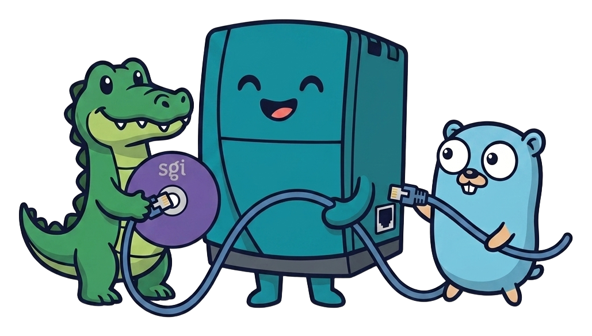

# instigator

<p align="center">
  
</p>

Instigator installs IRIX over the network from SGI CD images and shares host
folders with SGI machines and emulators. It is a single Go binary for Linux,
macOS, and Windows.

For installs, it reads the images directly and provides BOOTP, TFTP, and rsh
for the SGI boot firmware (PROM) and IRIX installer (`inst`). Several discs
can become one distribution tree, so you don't have to extract the media,
build a separate install tree, or swap sources by hand. The images stay
read-only. If two discs disagree about a file, you choose which copy wins in
the configuration.

For file sharing, it runs its own writable NFSv2/v3 server. Use it to move
files between your host and IRIX without configuring a host NFS service. With
an emulator's private QEMU network, it runs without root or privileged host
ports. Install services and shares can run together or separately.

## Start here

| I want to… | Guide |
| --- | --- |
| Install IRIX using a ready-made media config | [Real hardware and shipped configs](docs/real-hardware.md) |
| Understand the installer prompts and finish an install | [Installation walkthrough](docs/install.md) |
| Use my own media or change package selections | [Configuration](docs/configuration.md) |
| Share a host folder with IRIX | [File sharing](docs/sharing.md) |
| Extract files or manual pages without installing IRIX | [Extraction](docs/extract.md) |
| Record an install, diagnose a connection, or run a service | [Operations](docs/operations.md) |

## Get Instigator

Download an archive for your host from the [releases
page](https://github.com/jamesbraid/instigator/releases) and unpack it.
Release archives include the example configuration, ready-made configs, and
these guides. Use the docs from the same release as your binary.

To build from a checkout, use Go 1.27.1 or newer:

```sh
go build -o instigator ./cmd/instigator
```

`./instigator --version` prints the version recorded by Go. Local changes add
`+dirty`. Builds without source metadata report `(devel)`.

The commands below assume the binary is in your current directory. On Windows,
use `instigator.exe`. Run host-network install services as Administrator
instead of using `sudo`.

## First install

The configs in [`configs/`](configs/) have media URLs filled in for IRIX
6.5.30 and 6.5.22. Choose one for your machine in the [hardware
guide](docs/real-hardware.md). For a 6.5.30 standard install:

```sh
cp configs/irix-6.5.30-standard.yaml instigator.yaml
cp -R configs/addons .
```

Edit `server_ip`, `netmask`, and the client MAC and IP. The supplied addresses
are placeholders. At the SGI PROM, `printenv eaddr` shows the MAC address. The
config uses remote media. Replace its `source` URLs with local paths if you
have your own copies. The second command copies the add-on files beside your
config so its relative paths work if you enable them.

Check it, then start the server:

```sh
./instigator check instigator.yaml
sudo ./instigator serve instigator.yaml
```

`check` probes remote URLs without downloading their contents and fully checks
sets made only from local media. Use `check --full` to assemble and validate
remote media too. `serve` assembles every set before serving it. A passing
check does not prove the media will boot your machine.

Leave the server running. It prints a disk-partitioner boot command and the
remote distribution directory. Follow the [hardware guide](docs/real-hardware.md)
to prepare the disk if needed, then start the installer from the maintenance
menu. It covers the 32-bit IP22 and 64-bit boot paths.
With a shipped config, load `/irix.cmds` at `Inst>` to apply its package
choices and add-ons. If an `Install software from` menu appears, enter the
number beside `done` to let the script continue.

## First file share

For a physical machine on your LAN, bind to the host's install-network
address. Replace `192.0.2.10` with that address:

```sh
mkdir -p "$HOME/sgi-share"
sudo ./instigator share --listen 192.0.2.10 src "$HOME/sgi-share"
```

On IRIX, as root:

```sh
mkdir -p /mnt/src
mount 192.0.2.10:/src /mnt/src
```

Guest writes change the host files. They run with the permissions of the user
who started Instigator. The [sharing guide](docs/sharing.md) explains
permissions, firewall ports, and how to use a private emulator network without
`sudo`.

## What has been tested

An Octane2 running IRIX 6.5.30 has netbooted, installed from merged media,
booted from disk, and reached console login using a Linux host. The IP22
config and boot path are present, but an Indy or Indigo2 install remains
untested on hardware.

The [NFS reference](docs/nfs-shares.md#checked-against-irix-6530) records IRIX
6.5.30 guest checks for file sharing. macOS and Windows are build and test
targets. That is separate from a completed hardware install on those hosts.
The [QEMU performance notes](docs/qemu-network-performance.md) give the
conditions and limits of the measured install comparison.

## Development

```sh
go test ./...
```

Tests cover media reading and merging, installer scripts, BOOTP/DHCP, TFTP,
rsh, NFS, private networking, extraction, and capture logs. Tests that need
local IRIX media skip when those files are unavailable:

```sh
go test -run RealMedia -v ./internal/vfs ./internal/instcmd ./cmd/instigator
```

The [NFS reference](docs/nfs-shares.md) covers protocol behavior and the
transcripts shared with Origami's Rust implementation. The
[roadmap](docs/roadmap.md) lists the remaining validation and possible work.

## License

[BSD 3-Clause](LICENSE). Dependency notices are in
[THIRD_PARTY_NOTICES](THIRD_PARTY_NOTICES).
